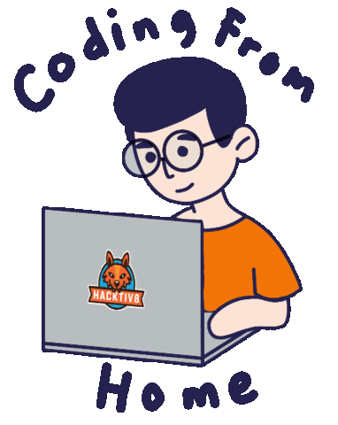

<h1 align="center">Hi!  I'm Dimas Triana 💙</h1>

  

<h3 align="center">Fullstack Developer · React · Next.js · TypeScript</h3>

  
  
  
  
  

  

---

## 👋 About Me

Fullstack Developer with **3+ years** of experience building production web apps with React, Next.js, and TypeScript. Started in frontend, and since early 2026 I build features end-to-end — from database and API to UI.

- 💼 **Frontend Developer (Fullstack Scope)** at **Kreatifcity**, working on **BukuJanji** — a booking platform for salons, clinics, sports venues, and classes
- 🤖 Recently built an **AI customer service assistant**, an **OpenAI-powered WhatsApp booking bot**, and **semantic search with pgvector**
- 🧪 Wrote **60+ end-to-end tests** in Playwright covering critical booking flows
- 🎓 Studying Information Systems at Universitas Terbuka

## 🚀 Featured Projects

<!-- Diisi otomatis dari dims-dev.vercel.app/projects.json. Edit di repo dims-dev, file data/projects.ts. -->
<!-- PROJECTS:START -->

### [Asetly](https://www.asetly.app/) — Personal Finance Platform

Web: asetly.app · Android: in Google Play closed testing

- Built the entire product solo: database schema, backend, web dashboard, and Android app
- Tracks bank, stock, and crypto assets in one place, with real-time crypto prices from the Indodax API
- Generates AI-powered portfolio allocation insights using OpenAI
- Web app live with 10+ early users; Android app built with React Native

`Next.js` `React` `React Native` `Supabase (PostgreSQL)` `OpenAI`

### [Minimart](https://minimart-app-orcin.vercel.app/) — Point of Sale & Inventory App

Live demo: minimart-app-orcin.vercel.app · Code: github.com/dimstry/minimart-app

- Rewrote my vocational school final project from PHP and MySQL to Next.js and Supabase, with a new UI
- Moved business rules into PostgreSQL: stock triggers, an atomic no-oversell constraint, and row-level security
- Built a keyboard-first cashier screen with barcode scanning, plus in-store barcode generation and printable labels
- Public demo with one-click role logins; data regenerated nightly with pg_cron, database logic tested on PGlite

`Next.js` `TypeScript` `Supabase (PostgreSQL)` `Tailwind CSS` `shadcn/ui`

<!-- PROJECTS:END -->

## 🛠️ Tech Stack

**Frontend & UI**

  

**Backend, Database & AI**

  
  

**Testing & Tools**

  
  

## 📊 GitHub Stats

  
  

  

